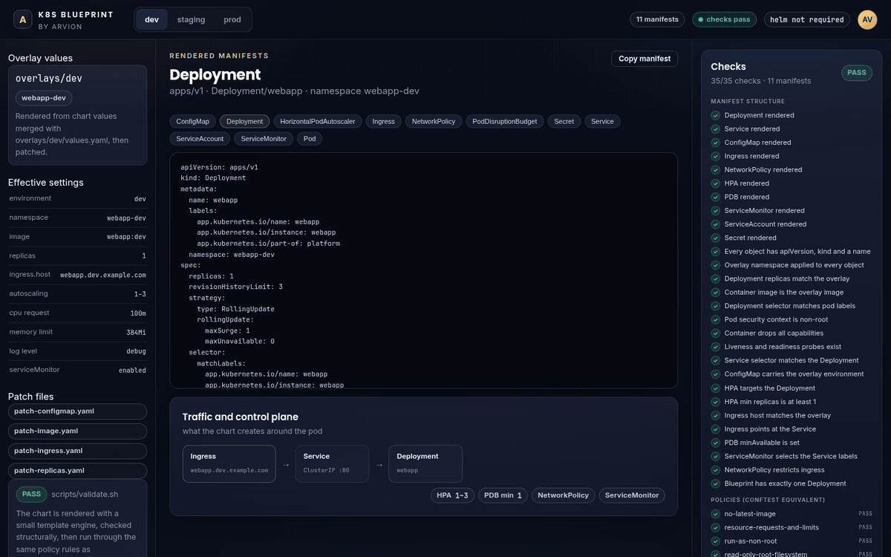
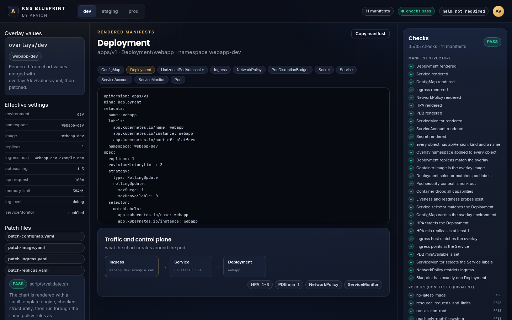

<div align="center">

</div>

<sub>Recorded from the live demo — <a href="docs/demo.mp4">MP4</a> · <a href="docs/screenshot.png">static frame</a></sub>

# K8s Blueprint

A production-shaped Kubernetes setup for one stateless web application: a Helm
chart with documented values, dev/staging/prod overlays that combine values and
Kustomize patches, HPA, PDB, NetworkPolicy, ServiceMonitor, probes, a locked-down
security context, conftest policies and a runbook.

[**Open the live demo**](https://arvion-technology.github.io/labs/demos/k8s-blueprint/demo/) · [MIT](LICENSE)

---

The hard part of a Kubernetes blueprint is not writing a Deployment. It is keeping
dev, staging and production honest with each other while the release-specific
fields — image tag, replica count, namespace — stay visible in a diff. This
repository separates those concerns: Helm values own the shape of the application,
Kustomize patches own the per-environment release fields, and a validator renders
every overlay and checks the result without requiring helm, kustomize or a
cluster.

The demo is the same renderer in your browser. Pick an overlay, pick a manifest,
and the YAML is produced from `chart/` and `overlays/` on the fly. The check panel
is not a screenshot: it runs the structural and policy rules against that output.

## What it renders

- **Deployment** — non-root, read-only root filesystem, all capabilities dropped,
  `seccompProfile: RuntimeDefault`, resource requests and limits, liveness and
  readiness probes on separate paths, `maxUnavailable: 0` rolling updates, a
  writable `emptyDir` at `/tmp`.
- **Service, Ingress and ConfigMap** — ClusterIP in front of the pod, ingress with
  TLS, and configuration mounted as environment variables.
- **Autoscaling and disruption** — HPA on CPU with per-environment bounds, and a
  PodDisruptionBudget that keeps one replica available during drains.
- **NetworkPolicy** — default-deny ingress except from the ingress-nginx namespace
  on the application port.
- **ServiceMonitor** — Prometheus Operator scrape config for `/metrics`.
- **ServiceAccount and Secret** — the token is not mounted; the Secret is a
  placeholder that a real cluster replaces with an external secret.
- **Helm test pod** — `helm test webapp` hits the health endpoint from inside the
  cluster.

## Screenshots

| dev overlay | prod overlay |
| --- | --- |
|  |  |

## Architecture

```
chart/                         source of truth
  Chart.yaml  values.yaml      documented defaults
  templates/                   deployment · service · ingress · configmap
                               hpa · pdb · networkpolicy · servicemonitor
                               serviceaccount · secret · tests/
        │
        ├── helm template ──► Kubernetes (when helm is available)
        │
        ▼
base/                          chart rendered with defaults (generated)
        │
        ▼
overlays/{dev,staging,prod}/
  values.yaml                  environment, host, autoscaling, resources
  kustomization.yaml           namespace + JSON 6902 patches
  patch-*.yaml                 image tag, replicas, config, host, HPA bounds
        │
        ▼
scripts/validate.sh            render → structural checks → Rego policies
src/render.js                  template subset engine used when helm is absent
src/checks.js                  manifest + policy rules (conftest equivalent)
```

### Environments

| Setting | dev | staging | prod |
| --- | --- | --- | --- |
| Namespace | `webapp-dev` | `webapp-staging` | `webapp-prod` |
| Replicas (patch) | 1 | 2 | 3 |
| Image tag (patch) | `:dev` | `:staging` | `:1.4.0` |
| `APP_ENV` | `dev` | `staging` | `production` |
| Log level | `debug` | `info` | `warn` |
| HPA | 1–3 | 2–8 | 3–12 |
| CPU request / memory limit | 100m / 384Mi | 100m / 384Mi | 250m / 512Mi |

Image tag and replica count live in the Kustomize patches rather than the Helm
values because those are the fields a release changes. Values own everything else.

## Quickstart

```bash
git clone https://github.com/arvion-technology/k8s-blueprint.git
cd k8s-blueprint
npm test             # 26 tests: renderer, chart, checks, demo sync
./scripts/validate.sh   # renders all three overlays; helm not needed
```

With helm and a cluster:

```bash
helm template webapp chart -f overlays/prod/values.yaml --namespace webapp-prod > /tmp/prod.yaml
kubectl diff -f /tmp/prod.yaml
helm upgrade --install webapp chart -n webapp-prod --create-namespace -f overlays/prod/values.yaml
```

With kustomize only:

```bash
node scripts/render-base.mjs
kubectl apply -k overlays/dev
```

`scripts/validate.sh` prefers the real tools when they are installed:

```text
node scripts/validate.mjs        always: render, structure, policies
helm template (if installed)     real engine, one render per overlay
conftest test (if installed)     policies/*.rego against the renders
```

## How it works

**A small template engine instead of a helm dependency.** Helm is not installed in
our CI. `src/render.js` implements the slice of Go templates this chart uses:
value interpolation, `if`/`else`/`end`, `include` of named defines from
`_helpers.tpl`, and whitespace trim markers. Anything else — `toYaml`, `range`,
sprig functions — throws instead of rendering something subtly wrong. If helm is
present, `validate.sh` renders with helm and compares the result; the fallback path
is a checked subset, not a guess.

**Kustomize patches are applied to parsed objects.** The overlays' JSON 6902 files
are parsed and applied to the rendered manifest as data, not string-substituted
into YAML. A patch whose target doesn't exist is reported, because a typo in a
target name would otherwise silently leave the default value in place.

**Structural checks are blueprint-specific.** Beyond "does the YAML parse", the
validator verifies that the Service selector matches the Deployment labels, that
the ingress points at that Service, that the ConfigMap carries the overlay's
`APP_ENV`, that the HPA targets the Deployment, and that the overlay namespace
reached every object. Those are the mistakes that produce a healthy-looking chart
and a broken rollout.

**Policy checks mirror the Rego.** `src/checks.js` enforces the same rules as
`policies/*.rego`: pinned images, requests and limits, non-root, read-only root
filesystem, no privilege escalation, no hostPath, probes present. The Node checks
run in CI without conftest; the Rego files are there for clusters that enforce
policy at admission time.

**base/ is generated, not hand-written.** `base/` is the chart rendered with
default values, committed so kustomize-only users have a base to patch. The tests
fail if base/ is older than the chart. It is deliberately a build artifact checked
into the repository, not a second source of truth.

## Tests

```bash
npm test
```

26 tests on `node:test`:

- `render.test.js` — interpolation, if/else/end, include, trim, unsupported
  expressions, deep value merge, JSON 6902 patches, YAML round-trips.
- `chart.test.js` — all eleven manifests render with valid metadata; security and
  probe fields; HPA/PDB/NetworkPolicy/ServiceMonitor; all three overlays apply
  namespace, replicas, image and config patches; base drift; generated demo data;
  patch targets exist.
- `checks.test.js` — every policy rule passes on the chart and fails when mutated;
  structural checks catch stale images, wrong replica counts, wrong ingress hosts
  and missing resources.

`./scripts/validate.sh` additionally renders each overlay and reports 35 checks per
overlay (105 total), plus a base drift check.

## Limitations

- **The template engine is a subset.** If you edit a template to use `range`,
  `toYaml` or sprig functions, the fallback renderer fails and the validator stops.
  That is intentional — install helm for full templating — but it means this chart
  is written conservatively.
- **No schema validation.** Values are not checked against a `values.schema.json`.
  A string where a number is expected reaches the template and produces YAML that
  Kubernetes rejects. Adding a schema is the next step for a team that edits values
  often.
- **Egress is not restricted.** The NetworkPolicy allows all egress, so a
  compromised pod can reach anything the network allows. Add per-dependency egress
  rules before calling the policy complete.
- **The ServiceMonitor requires the Prometheus Operator.** It is a CRD from
  `kube-prometheus-stack`; on a cluster without it, disable
  `serviceMonitor.enabled`.
- **The Secret is a placeholder.** `secret.enabled` renders a `stringData` value
  from values. Real clusters should use an external secret store and set
  `secret.enabled=false`.
- **No database, no migration job, no backup.** This blueprint owns the stateless
  workload. State, migrations and restores are environment concerns; the runbook
  describes the expected shapes but does not implement them.
- **Kustomize's `helmCharts` generator is not used.** Overlays patch a pre-rendered
  base. A team that prefers `kustomize build --enable-helm` should keep the values
  and drop `base/`.

## Project layout

```
chart/                     Helm chart: metadata, values, 12 template files
base/                      chart rendered with defaults (generated)
overlays/
  dev/  staging/  prod/    values.yaml + kustomization.yaml + JSON patches
policies/                  conftest Rego: no latest, resources, security, probes
docs/architecture.md       layer diagram and environment differences
docs/runbook.md            deploy, rollback, migrations, probes, secrets
src/render.js              template subset + overlay patching
src/checks.js              structural checks and policy rules
src/yaml.js                YAML parser/serialiser for manifests
scripts/validate.sh        CI entry point
scripts/validate.mjs       render + check every overlay
scripts/render-base.mjs    regenerate base/ from chart defaults
scripts/sync-demo.mjs      regenerate demo/chart-data.js
demo/                      manifest explorer driven by the real chart
```

## Credits

Built by [Arvion Technologies](https://arviontech.net) in Kathmandu. MIT licensed.
